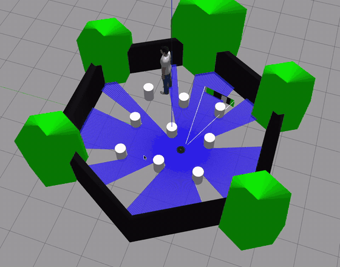

# Autonomous Perception-to-Navigation Pipeline (ROS2)

An end-to-end robotics pipeline: a mobile robot that finds a person with YOLOv8,
drives to them and stops at a following distance, steering around obstacles with
its LiDAR. It was built in two stages:

1. **2D (turtlesim):** a closed-loop heading controller turns the robot to face a
   person and keep them centered, the way a humanoid turns its head.
2. **3D (TurtleBot3 Waffle in Gazebo):** the same perception and controller, plus
   camera-LiDAR fusion, target memory and a corridor-based local planner, so the
   robot drives to the person through a field of pillars without touching any.

Built as a hands-on exploration of the Robotics & AI stack: computer vision,
ROS2 middleware, sensor fusion, closed-loop control, navigation and simulation.



*TurtleBot3 in Gazebo, 3× speed. Blue: the 360° LiDAR. White lines: the camera's field of
view. The robot spots the person, then drives around the pillars to them.*

## Roadmap

| Stage | Status | Notes |
|---|---|---|
| Object detection (YOLOv8 + OpenCV) | ✅ Done | `cv_detection/`: image/video/webcam |
| ROS2 node/topic pub-sub pattern | ✅ Done | `minimal_demo/` |
| Perception node → decision node | ✅ Done | `yolo_detector`: `detector` + `reactor` |
| Closed-loop target following | ✅ Done | `follower`: P-control with ego-motion prediction, detection-loss handling |
| Performance evaluation | ✅ Done | Per-tick CSV log + run summary (detector rate, detection rate, latency, settling time, following error, loss events) |
| 3D follower: camera-LiDAR fusion + obstacle avoidance | ✅ Done | TurtleBot3 in Gazebo: reached the person in both test placements with 0 collisions; 86.5% completion and 0 collisions over 200 trials in a 2D replica of the world |

## What's in here

| Folder | What it does |
|---|---|
| `cv_detection/` | Standalone YOLOv8 + OpenCV object detection (image/video/webcam) |
| `ros2_ws/src/minimal_demo/` | Minimal ROS2 publisher/subscriber pair, the basic node/topic pattern |
| `ros2_ws/src/yolo_detector/` | The pipeline: `detector` (perception), `reactor` (rule-based decisions), `follower` (closed-loop control and navigation), launch files for turtlesim and Gazebo |

## Stage 1: turtlesim

### Architecture

```
          /turtle1/pose (heading)
 turtlesim ─────────────────────────►  detector
    ▲                                  virtual pan camera → YOLOv8n
    │                                        │
    │                          /detected_objects (JSON: boxes + capture stamp)
    │                                        ▼
    └───────── /turtle1/cmd_vel ◄──────  follower
               (angular velocity)        P-control + TRACKING / COASTING / SEARCHING
```

**Why a virtual camera?** Turtlesim has no sensors, so turning the turtle wouldn't
change what YOLO sees, and the loop would be open. The detector places a real photo
in a 360° world and crops the slice the turtle is facing, based on its heading from
`/turtle1/pose`. When the follower turns the turtle, the view pans and the target
moves across the frame, so each control command changes the next measurement.
That makes it a real closed loop.

The nodes stay decoupled: the detector doesn't know who's listening, and the
follower doesn't know a neural network is involved. Swap turtlesim for a real
robot's `/cmd_vel` and a real camera, and neither side changes.

### How the follower works

**Control law.** With `err = target_cx / frame_width − 0.5` (−0.5 far left, +0.5 far right):

```
pred_err         = err + (rotation since that frame) / FOV
angular_velocity = clamp(−kp · pred_err, ±max_angular)     # zero inside a small deadband
```

**Ego-motion prediction.** The follower integrates its own commanded rotation since the
last sighting. Turning by `d` radians shifts the scene by `d / FOV` of the frame, so it can
predict where the target is *now*, not where it was in the last frame. That is used twice:

- in the control law, so a slow detector doesn't cause overshoot (on a 2 frames/s detector
  the robot otherwise keeps turning for ~0.5 s on a stale measurement)
- in data association, so with several people in view it stays locked on the same one while turning

**Detection loss.** States are driven by what the detector reports, not by elapsed time, so
a slow detector isn't mistaken for a lost target:

| State | When | Behaviour |
|---|---|---|
| `WAITING` | no detector message yet (YOLO still loading) | stay still |
| `TRACKING` | latest frame contains the target | apply the P-controller |
| `COASTING` | a frame arrived without the target | decay the last command smoothly instead of jerking to a stop |
| `SEARCHING` | target not seen for 1.5 s | rotate slowly toward the side it was last seen on |

**Results on ROS2** (turtlesim + YOLOv8n on CPU, WSL2 on a laptop, 40 s run,
from the follower's own run summary):

| Metric | Value |
|---|---|
| Detector rate | 5.05 Hz |
| Target detection rate | 98.5 % |
| Perception latency (capture → controller), median / p95 | 85.6 ms / 104.3 ms |
| Time to acquire (from first detector frame) | 0.4 s |
| Time to center | 2.16 s |
| Mean steady-state following error | 1.3° |
| Target losses | 0 |

Writing the debug image to the Windows filesystem every frame dropped the detector to
~2 Hz in an earlier run, so it's throttled to once per second.

**Simulation results** (`test/sim_closed_loop.py`: real YOLOv8n on the same scene, robot
heading integrated like turtlesim, 0.8 s and 2 s occlusions injected):

| Detector rate | Ego-motion prediction | Identity switches | Steady-state error | Time to center |
|---|---|---|---|---|
| 5 Hz | off | 7 | 2.70° | 1.6 s |
| 5 Hz | on | **2** | **2.35°** | 1.8 s |
| 2 Hz | off | 0 | 5.06° | 3.9 s |
| 2 Hz | on | 1 | **3.61°** | **1.9 s** |

At 5 Hz the main gain is staying on the same person. At 2 Hz it halves the time to center
by removing overshoot, at the cost of one extra switch. Remaining switches happen when
re-acquiring after the long occlusion, where any visible person is a valid pick.

## Stage 2: TurtleBot3 in Gazebo (3D)

```
 Gazebo camera ──/camera/image_raw──► detector (YOLOv8n) ──/detected_objects──┐
 Gazebo LiDAR  ──/scan───────────────────────────────────────────────────────► follower ──/cmd_vel──► TurtleBot3
 Gazebo odom   ──/odom───────────────────────────────────────────────────────►  (drive:=true)
```

The heading controller from stage 1 is unchanged. In drive mode the follower adds a motion
planner (`navigation.py`, no ROS imports, so it's testable offline):

**Camera-LiDAR fusion.** The camera knows *where* the person is (bearing) but not how far;
the LiDAR knows distances but not *what* it's seeing. The scan is grouped into objects
(clusters of neighbouring returns), and the detection is matched to the object whose centre
lines up with it as seen from the camera, which sits 13 cm in front of and 6.5 cm beside the
LiDAR on a Waffle. Walls (long clusters) and partly hidden wall segments are excluded. When a
pillar and the person line up, the camera's rough range from box width breaks the tie: a
person that close would look at least 2.5× bigger.

**Target memory.** The person's position is stored in the odometry frame on every trusted
LiDAR match, with an outlier gate (a jump over 0.6 m needs 3 agreeing readings). Going around
a pillar usually turns the person out of the 62° camera view; instead of stopping to search,
the robot keeps heading for the remembered spot, which brings them back into view.

**Local planner.** Every tick, 36 headings are scored by whether a corridor as wide as the
robot (+8 cm each side) is clear for 0.8 m. The robot steers to the clear heading closest to
the goal, with a penalty for switching sides so it commits to one way around an obstacle. It
never drives forward with anything in its own corridor closer than 12 cm, whatever the camera
says. With no memory and nothing found after a full 360° search, it drives a short leg toward
the most open heading and searches again.

**Results in Gazebo** (TurtleBot3 Waffle, YOLOv8n on CPU, WSL2 on a laptop; numbers from the
follower's own run summary):

| Metric | Open path | Person behind the pillar row |
|---|---|---|
| Task completed (within 0.8 ± 0.15 m, facing the person, held 1 s) | ✅ 35.8 s | ✅ 64.0 s |
| Collisions | 0 | 0 |
| Closest approach to any obstacle | 16 cm | 5.6 cm |
| Mean following-distance error after arriving | 5.8 cm | 9.1 cm |
| Mean heading error while tracking | 1.8° | 3.9° |
| Distance driven | 2.6 m | 2.9 m |
| Detector rate / median capture-to-controller latency | 3.1 Hz / 200 ms | 3.8 Hz / 192 ms |
| Frames in which YOLO found the person | 79.5 % | 52.4 % |
| Time detouring / exploring / searching | 0 / 0 / 1 % | 30 / 8 / 14 % |

In the second placement the person is hidden behind pillars for most of the run (YOLO only sees
them in half the frames), so the robot detours, loses them, explores, re-acquires and finishes
on target memory. The detector is limited to ~3–4 Hz because Gazebo renders the world and the
1920×1080 robot camera on the same CPU (no GPU passthrough in WSL2).

**Validation without Gazebo** (`test/sim_tb3_world.py`): a 2D replica of the TurtleBot3
world (3×3 pillars, hexagon walls), a 360-beam LiDAR ray-cast at 5 Hz with noise, a 62° camera
that loses the person behind pillars, 5% missed detections, and the real controller and
planner code driving it. 200 random start/person placements:

| Metric | Result |
|---|---|
| Task completion (within 0.8 ± 0.25 m, facing the person, for 1 s) | 86.5 % |
| Trials with any collision | 0 / 200 |
| Closest approach to any obstacle | 3.5 cm |
| Median time to complete | 26 s |

Getting there took several rounds of tracing failures: a ±25° front cone missed pillars beside
the robot (fixed with the robot-width corridor); the "closest return near the camera bearing"
matched pillars next to the person (fixed with object clustering and parallax correction); and
reactive avoidance oscillated in front of pillars (fixed with heading selection plus target
memory). The remaining ~13% are placements where pillars hide the person from every spot the
robot reaches in 60 s.

## Running it

Requires ROS2 Humble ([install guide](https://docs.ros.org/en/humble/Installation.html)) and `pip install ultralytics`.

### 1. Object detection only (no ROS2)

```bash
cd cv_detection
python3 -m venv venv && source venv/bin/activate
pip install -r requirements.txt
python detect.py --source test.jpg --save
```

### 2. Closed-loop follower (one command)

```bash
cd ros2_ws
colcon build --packages-select yolo_detector
source install/setup.bash
ros2 launch yolo_detector follow_demo.launch.py
```

The follower waits for YOLO to load, then the turtle (which starts facing away from the
scene) searches, locks onto a person, and turns until they're centered. Press `Ctrl+C` to stop. The follower then prints a run summary and
saves `follower_log.csv` + `follower_log_summary.json`.

Useful options:

```bash
# watch what the robot sees (overwritten every frame, open it in an image viewer)
ros2 launch yolo_detector follow_demo.launch.py debug_image:=$HOME/robot_view.jpg

# follow something else, or tune the gain
ros2 launch yolo_detector follow_demo.launch.py target_label:=bus kp:=1.5
```

### 3. TurtleBot3 in Gazebo (3D)

Needs `ros-humble-turtlebot3-gazebo` and the `person_standing` model in `~/.gazebo/models`
(from [osrf/gazebo_models](https://github.com/osrf/gazebo_models)).

```bash
ros2 launch yolo_detector tb3_follow.launch.py
ros2 launch yolo_detector tb3_follow.launch.py person_x:=1.5 person_y:=0.6   # behind the pillar row
```

This starts the TurtleBot3 world, spawns the person, and runs the detector and the follower in
drive mode. `Ctrl+C` prints the run summary, including collisions, minimum clearance, task
completion time and following-distance error.

**Gazebo on WSL2.** Gazebo Classic hung at startup (`/spawn_entity` never appeared) and then
the robot fell through the floor. Both were configuration, not graphics:

```bash
source /usr/share/gazebo/setup.sh            # puts ground_plane/sun back on the model path
export GAZEBO_IP=127.0.0.1                   # otherwise gzserver hangs resolving its own address
export GAZEBO_MODEL_DATABASE_URI=""          # don't try to download models at startup
```

### 4. Nodes individually

```bash
ros2 run turtlesim turtlesim_node
ros2 run yolo_detector detector --ros-args -p source:=sample -p virtual_pan:=true
ros2 run yolo_detector follower
ros2 run yolo_detector reactor       # optional: rule-based decisions, prints only
```

`source` can be `sample` (bus photo bundled with ultralytics), a webcam index (`0`), an
image path, or a video file (loops at the end). `virtual_pan` needs an image.

### 5. Offline simulations (no ROS2)

```bash
cd ros2_ws/src/yolo_detector
python test/sim_closed_loop.py      # stage 1: heading control on the virtual camera
python test/sim_tb3_world.py 200    # stage 2: navigation in the 2D TurtleBot3 world
```

## Message format

`/detected_objects` is a `std_msgs/String` with JSON, to keep the demo dependency-free.
A production version would define a custom `.msg` type.

```json
{"stamp": 1730012345.12, "frame_w": 640, "frame_h": 1080,
 "detections": [{"label": "person", "confidence": 0.91, "cx": 312.5, "cy": 540.0, "w": 140.0, "h": 420.0}]}
```

`stamp` is the frame capture time. The follower uses it to measure perception latency
(capture → box arrives at the controller).

## Stack

- **YOLOv8n** (Ultralytics): pretrained on COCO, single-stage anchor-free detector
- **OpenCV**: frame capture, image I/O, annotation
- **ROS2 Humble**: nodes, topics, parameters, launch files, built with `colcon`
- **turtlesim**: 2D robot simulator (stage 1)
- **Gazebo Classic + TurtleBot3 Waffle**: 3D simulation with camera, 360° LiDAR, odometry (stage 2)

## Limitations and next steps

- The local planner is reactive (no map). A person hidden behind several pillars can need
  more exploration than a 60 s budget allows; a costmap and a global planner (Nav2) would
  handle that.
- The robot never reverses: if the person walks up to it, it holds position rather than
  backing away. The LDS can't see within 12 cm, which covers the robot's back edge.
- Odometry drift isn't corrected, so target memory degrades over long detours.
- The ego-motion prediction uses rotation since a detection *arrived*, not since the frame
  was captured. Using the capture stamp would remove the remaining lag.
